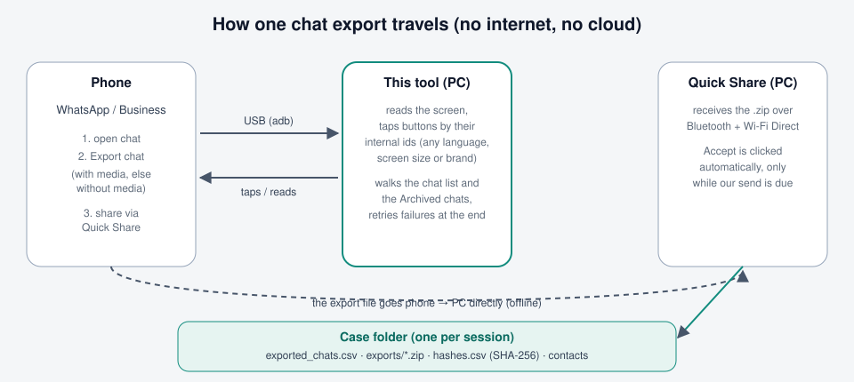
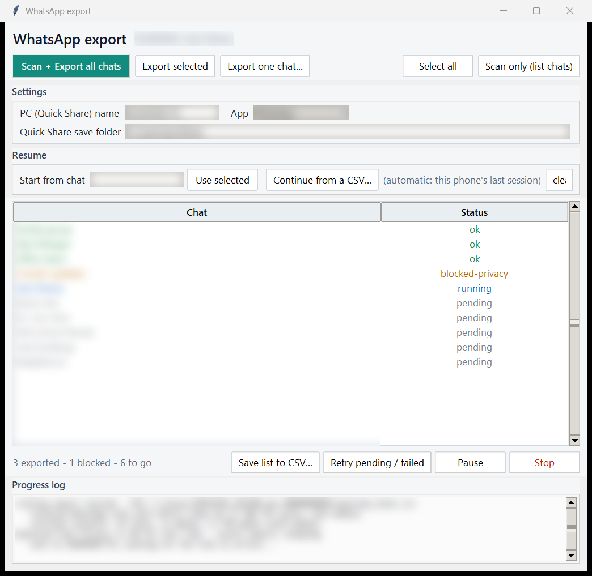
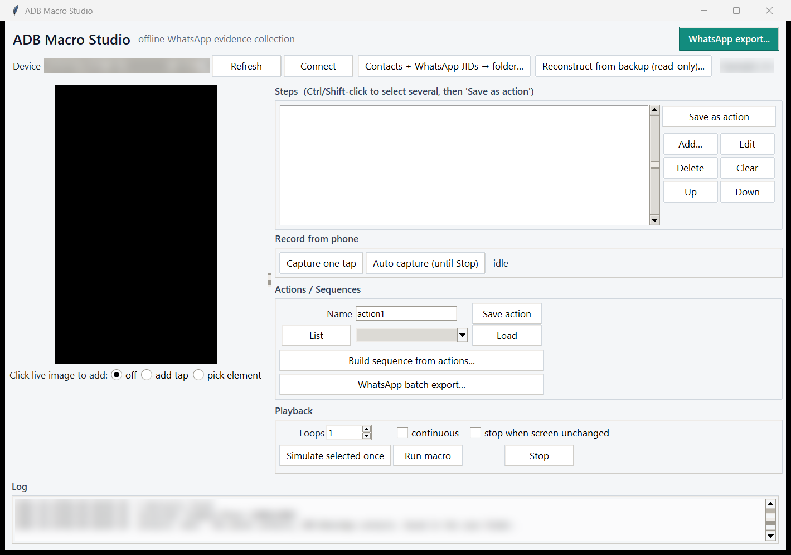

# ADB Macro Studio

An **offline** desktop tool to **record, save, and replay repetitive taps/swipes on an
Android phone over ADB** — without rooting, and without installing anything on the phone.
Built for workflows where you repeat the same on-screen steps across many devices
(QA, kiosk setup, bulk configuration, forensic *logical* extraction, etc.).

- 🖥️ **Live phone screen** inside the app (read-only screenshots — nothing is written to the phone).
- 👆 **Capture taps** by tapping the phone, clicking the live image, or via **auto-capture** (records everything until you press Stop).
- 🧩 **Actions & Sequences** — group taps into named *actions*, then chain actions into a *sequence* and run it.
- 🔁 **Replay** once, N times, continuously, or until the screen stops changing.
- 📐 **Cross-device** — macros remember the resolution they were recorded at and are auto-scaled to the connected phone.
- 🧾 **Audit trail** — every adb command and every pulled/saved file (with SHA-256) is logged to a per-device case folder.
- 🐍 **Zero dependencies** — pure Python standard library + the `adb` executable.

There is also a **headless CLI** (`adb_cli.py`) for machines with no display.

> 📄 For how the WhatsApp batch exporter guarantees a **complete, non-duplicated, verifiable**
> collection (and what to watch for in the field), see **[docs/RELIABILITY.md](docs/RELIABILITY.md)**.

## Screenshots

All screenshots use **made-up sample data** (invented chat names, a dummy device code and PC name),
and every field that would hold real case data — device, PC name, save folder, chat names, file
paths in the log — is additionally **blurred**.

**How an export travels** — the phone exports a chat, the tool drives WhatsApp over USB, and the
file goes straight from the phone to this PC over Quick Share (offline). Everything for one session
ends up in one case folder.



**The WhatsApp export window** — the green **Scan + Export all chats** button is the main action
(no separate scan needed). *Export selected* and *Export one chat…* export just those chats. The
Status column shows each chat's result as it happens: `ok` (received and hashed),
`blocked-privacy` (WhatsApp's Advanced Chat Privacy forbids export), `running`, `pending`, or a
`fail-…` reason. Settings holds the PC's Quick Share name, the folder Quick Share saves to, and which
app to export (WhatsApp or WhatsApp Business).



**The main window** — pick and connect the phone, extract contacts with their WhatsApp IDs,
rebuild chats from a backup (read-only), and record/replay tap macros. The green **WhatsApp
export…** button (top right) opens the export window above.



> ⚠️ **Use responsibly.** Only use this on devices you own or are explicitly authorized to
> access. Enabling USB debugging and sending input events modifies device state; in a
> forensic context, document what you do. This project is provided as-is under the MIT license.

---

## 1. Requirements

| Need | Details |
|------|---------|
| **Python 3.8+** | With **tkinter** (bundled on Windows/macOS; on Linux run `sudo apt install python3-tk`). |
| **Android platform-tools (`adb`)** | Download from Google (see below). |
| **A phone with USB debugging** | Any Android device, connected by a **data** USB cable. |

### Install `adb` (Android platform-tools)
1. Download **SDK Platform-Tools** for your OS from Google:
   <https://developer.android.com/tools/releases/platform-tools>
2. Unzip it somewhere, e.g. `C:\platform-tools`.
3. Make `adb` findable in **one** of these ways:
   - **Add it to your PATH** (recommended), **or**
   - Set an environment variable `ADB_PATH` to the full path of `adb`, e.g.
     `C:\platform-tools\adb.exe`, **or**
   - Drop it in a common location (`C:\platform-tools\`, the Android SDK, etc.) — the app auto-detects these.

Verify:
```bash
adb version
```

### Already have `adb` in another folder? (point the tool at it)
You don't have to move it. Tell the tool where it is with the **`ADB_PATH`** variable —
which must be the **full path to the `adb.exe` file**, not the folder.

Example: adb lives at `D:\tools\platform-tools\adb.exe`, app extracted to `C:\adb-macro-studio`.

**A. Just for this run (Command Prompt):**
```bat
cd /d C:\adb-macro-studio
set ADB_PATH=D:\tools\platform-tools\adb.exe
python adb_gui.py
```

**B. Or add the folder to PATH for this run** (here you point at the *folder*):
```bat
set PATH=%PATH%;D:\tools\platform-tools
python adb_gui.py
```
> **What that line means:** `PATH` is the list of folders Windows searches when you type a
> command like `adb`. Entries are separated by semicolons (`;`). `%PATH%` means "everything
> already in PATH", so the line reads: *new PATH = (everything already there) + `;` + the adb
> folder* — it **appends** the folder while keeping the rest.
> ⚠️ Always include `%PATH%;`. Writing just `set PATH=D:\tools\platform-tools` would **erase**
> the existing list for that window and break other commands. (This change is temporary — it
> only affects that one Command Prompt window.)

**C. Set it once, permanently** (`setx` — then open a NEW window):
```bat
setx ADB_PATH "D:\tools\platform-tools\adb.exe"
```

PowerShell equivalent of A: `$env:ADB_PATH = "D:\tools\platform-tools\adb.exe"`.
macOS/Linux: `export ADB_PATH=/path/to/adb`.

When the app starts, the **Log box** shows the adb it picked (e.g. `adb: D:\tools\platform-tools\adb.exe`) so you can confirm.

---

## 2. Get the code

Download the ZIP from GitHub (green **Code → Download ZIP**) and extract it, **or** clone:
```bash
git clone https://github.com/KotlaAvinash/adb-macro-studio.git
cd adb-macro-studio
```

---

## 3. Run

### Windows — Command Prompt (cmd)
```bat
cd C:\path\to\adb-macro-studio
python adb_gui.py
```
If `python` isn't recognised, use the launcher:
```bat
py adb_gui.py
```
To point at a specific adb for this run:
```bat
set ADB_PATH=C:\platform-tools\adb.exe
python adb_gui.py
```

### Windows — PowerShell
```powershell
cd C:\path\to\adb-macro-studio
$env:ADB_PATH = "C:\platform-tools\adb.exe"   # optional
python adb_gui.py
```

### macOS / Linux
```bash
cd /path/to/adb-macro-studio
export ADB_PATH=/path/to/adb        # optional if adb is on PATH
python3 adb_gui.py
```

### Headless / no display (CLI)
```bash
python adb_cli.py
```

---

## 4. Connect the phone

1. On the phone: **Settings → About phone → tap "Build number" 7 times** to enable Developer options.
2. **Settings → Developer options → turn on USB debugging.**
3. Plug the phone into the PC with a **data** USB cable; set the USB mode to **File transfer (MTP)**.
4. Run `adb devices`. On the phone, tap **"Allow USB debugging"** and tick **"Always allow from this computer"**.
   You want the device to show up as `device` (not `unauthorized` or `offline`).

```bash
adb devices
```

---

## 5. Using the GUI

1. **Refresh → Connect** — the live screen appears and the top bar shows the model/resolution.
2. **Capture taps** (any of):
   - **Capture one tap** → then tap the phone (or click the live image) → one step recorded.
   - **Auto capture (until Stop)** → tap/swipe freely on the phone → **Stop**. Everything is recorded.
   - **Add…** → a dialog where you can type X/Y, or click **📍 Tap the phone to fill X/Y**.
   - **Click live image to add:** `add tap` / `pick element` — click the on-screen image to add a tap or an element-based (`tap_text`) step.
3. **Group into actions** — select steps in the list (Ctrl/Shift-click for several) → **Save as action**, give it a name (e.g. `action1`). Repeat for `action2`, `action3`…
4. **Build a sequence** — **Build sequence from actions…** → add saved actions in order → **Save sequence**. It auto-loads.
5. **Run** — **Simulate selected once** (one step, live) or **Run macro** (Loops / continuous / stop-when-screen-unchanged).
6. **Pull data off the phone** — add a `pull` step (**Add… → type `pull`**) with a phone path (e.g. `/sdcard/DCIM`); files land in `cases/<timestamp>_<serial>/pulled/` with SHA-256 hashes logged.

### Step types available
`tap`, `long_press`, `swipe`, `text`, `key`, `wait`, `launch` (open an app), `tap_text` /
`wait_text` (find & tap a UI element by text/id — resolution-independent), `if_text`
(conditional branch — see below), `screenshot`, `ui_dump`, `pull`.

### Conditional branching (`if_text`)
`if_text` reads the screen and runs one set of steps if a word/phrase appears, another set if
it doesn't — so a macro can react to popups and different screens. Fields: `text` (what to look
for), `match` (`contains`/`exact`), `timeout` (how long to watch), and `or_text` (as soon as
this appears, take the *else* path — avoids waiting the full timeout on the success screen).
The step carries two nested step lists, `then` and `else`. Example (retry an export "without
media" only if the "unable to export" popup shows):

```json
{
  "type": "if_text", "text": "Unable to export", "match": "contains",
  "timeout": 120, "or_text": "Quick Share",
  "then": [
    {"type": "tap_text", "text": "OK", "delay": 1},
    {"type": "tap_text", "text": "Export chat", "delay": 1.5},
    {"type": "tap_text", "text": "Without media", "delay": 1}
  ],
  "else": []
}
```

Because it taps by **text** (via `uiautomator`), the same macro works across screen sizes and
UI variations without any fixed coordinates.

---

## 6. Presets (ready-made macros)
The [`presets/`](presets/) folder ships example macros. Notably
[`whatsapp_export.json`](presets/whatsapp_export.json) exports a WhatsApp chat/group by
reading the screen (no coordinates; works for chats and groups), trying with media and
falling back to without-media if the export popup appears. To use one, copy it into `macros/`
and **Load** it in the app. See [presets/README.md](presets/README.md) for details.

## 7. Collecting WhatsApp chats

There are two methods. See [docs/RELIABILITY.md](docs/RELIABILITY.md) for how each stays
evidence-safe.

### 7a. Read-only backup extraction (whole phone, recommended) — [`wa_backup.py`](wa_backup.py)

**Writes nothing to the phone.** It `adb pull`s the files WhatsApp already keeps on shared storage
(the encrypted `msgstore.db.crypt15` backup and the `Media` folder), decrypts the backup with the
device's 64-character backup key, and rebuilds **every** chat on the PC as a WhatsApp-export-style
`.zip` (`_chat.txt` + media) — so the viewer below and the SHA-256/CSV manifest work unchanged. Far
faster than Quick Share, no duplicates, and it includes chats too large to export with media.

In the app: **Reconstruct from backup (read-only)...** — pull from the connected phone, or point it
at a `.crypt15` (+ key) or an already-decrypted `msgstore.db`. Or from the command line on a
decrypted DB:
```bash
python wa_backup.py msgstore.db out_dir "path\to\WhatsApp\Media"   # or omit media / --no-media
```
Needs [`wa-crypt-tools`](https://pypi.org/project/wa-crypt-tools/) (`pip install wa-crypt-tools`) to
decrypt, and the device's backup key. Freshness = WhatsApp's last on-phone backup.

### 7b. Batch export per chat to the PC (Quick Share)

The app can also walk **every** WhatsApp chat and save each export straight to this PC over
**Quick Share** — no cloud, no cable copy, fully **offline** (Bluetooth + Wi-Fi Direct). Every saved
file is SHA-256 hashed and logged to a CSV. Use this for specific chats, or when a current backup
isn't available.

### One-time setup
1. Install **Quick Share for Windows** on the PC and sign in; set it to **receive** and choose a
   **save folder** (e.g. `Downloads` or a case folder).
2. On the phone, make sure **Quick Share** is available in WhatsApp's share sheet and that the PC
   shows up as a nearby device (Bluetooth **and** Wi-Fi on, on both).
3. In the app's batch window, set two fields to match your setup:
   - **PC name** — exactly as the phone sees this PC in the Quick Share device list.
   - **Save folder** — the same folder Quick Share for Windows saves incoming files to.

> **Hands-off Accept (optional):** the app can auto-click the Windows Quick Share **Accept**
> button for you, but that needs the third-party **`pywinauto`** package:
> ```bash
> pip install pywinauto
> ```
> **Without it the tool still works** — the export and Quick Share send run normally and the file
> is still received and hashed — you just click **Accept** yourself on each transfer. If your
> Windows is not in English, adjust the accept label in `qs_accept.py` (`ACCEPT_LABELS`): Quick
> Share for Windows gives its buttons no language-free id, only their visible text.

### Any phone language, any brand, WhatsApp Business
- **Phone language:** WhatsApp's buttons are found by their internal ids, which are the same in
  every language. The one exception is **Export chat**, which sits in the same menu as **Clear chat**
  with the same id, so it is matched by its text. English is built in. For any other language,
  the first time the tool asks you to pick the item that means "Export chat" from the phone's
  own menu. It remembers your answer for that phone language (`.ui_labels.json`), so you are asked
  once. The tool never guesses a menu item.
- **Phone brand:** Samsung and Google Quick Share are both handled. The Quick Share tap position the
  tool learns is saved per **phone model** (not only per screen size), so it is never reused on a
  different phone.
- **WhatsApp Business:** pick **App: WhatsApp Business** in the batch window. It is only offered
  when it is installed. Its progress is kept in its own CSV, `exported_chats_business.csv`, so
  resuming one app never skips the other's chats. Backup extraction reads its folder
  (`Android/media/com.whatsapp.w4b/WhatsApp Business`).

### How the rolling export works
Click **Scan + Export all chats**. It does **not** pre-scan the whole list: it goes to the very top
of the chat list (with the **All** filter tab on, so no Unread/Groups tab hides chats), exports the
chats on screen, scrolls one page and repeats to the bottom — then does the same for the **Archived
chats** — and finally gives every chat that failed **one more attempt**. Per chat it:

1. Opens the chat and exports it, **trying "with media" first** and automatically falling back to
   **"without media"** if WhatsApp says the export is too large.
2. Shares the resulting file to this PC via **Quick Share**, waits for it to land in the save
   folder, and records its **SHA-256**.
3. Writes a row to the CSV, then moves to the next chat.

**Buttons:** *Scan + Export all chats* (the main action), *Export selected*, *Export one chat…*,
*Scan only* (just list the chats, saved to the case folder), *Pause/Resume*, *Retry pending /
failed*, *Save list to CSV*, and *Stop* (halts within a few seconds — it also interrupts an
in-progress export).

**Export only some chats:** *Scan only* lists every chat (main list + Archived); **select the ones
you want** and click *Export selected* — the rest are marked `skipped`. To redo **one** chat (e.g. one
that failed), click *Export one chat…* and type its name: it finds the chat in the list or in
Archived, exports it, and stops. A chat you choose is exported even if an earlier run already got it.

**Scrolling on any phone:** the list is scrolled by its own measured rows (not fixed screen
fractions), and after each page the tool checks the last chat it saw is still on screen — so no chat
is skipped on any screen size, display density, font size or brand. Before tapping a chat it waits
for the list to stop moving, and after opening it checks the chat's title, so a wrong chat is never
exported under another chat's name.

### Everything in one case folder
Each session (each **Connect**) gets its own case folder, and everything for that session is saved
there: each contacts collection in its own `contacts_<time>_<id>/` folder (`contacts.csv`,
`whatsapp_contacts.csv` with WhatsApp IDs, and the raw query output — a repeat never overwrites an
earlier one, and a failed query is reported as an error, not "0 contacts"), the scanned chat
list, **`exported_chats.csv`**, a **verified copy of every received export** under `exports/`, and
`hashes.csv` + `session.log` (SHA-256 of every file). When a run continues an earlier session's
progress, the earlier CSV is only **read** (its finished chats are skipped) and left untouched.

### Resume after an interruption (lock / crash / disconnect)
So you never have to redo work if the phone locks or the run stops midway:
- **Continue from a CSV…** — pick a previous run's `exported_chats.csv`. Chats already `ok` are
  **skipped**; everything else (failed / pending / never-reached) is **re-queued and retried**.
  Without picking one, the phone's last session is continued automatically.
- **Start from chat** — type a chat name and the run scrolls to it and **begins there** (chats
  above it are marked `skipped`). Handy to pick up exactly where it stopped.
- The run also **keeps the screen awake** and, if the screen locks or the device drops, it **wakes
  it, re-arms stay-on, and returns to the chat list** before continuing.

> Note on missed chats: every page move is verified (the last chat seen must still be on screen
> afterwards), the ends of the list are confirmed by scrolling the other way and back, and the
> Archived chats are included — so a chat can't be scrolled past unread.

### Skip chats that take too long
Some very large chats make the phone too busy for the screen-reader (Android can even kill the
UI-dump helper under memory pressure). To stop one chat from stalling the whole run, each chat has
a time budget — **`MAX_SEND_SECONDS`** in `whatsapp_batch.py` (default **180 s**) — to reach the
"sent" point. If it's exceeded, the chat is marked **`fail-timeout`** in the CSV and the batch
moves on. (The file transfer itself keeps a separate, longer timeout.)

### The CSV (audit log)
Written to `cases/<timestamp>_<serial>/exported_chats.csv` and **rewritten after every chat**, so
it's always current — even mid-run and even for failures. Columns:

| Column | Meaning |
|--------|---------|
| `#` | Row number in discovery order |
| `chat` | Chat/group name (sanitised against spreadsheet formula injection) |
| `status` | `ok`, or a `fail-*` reason (see below), `pending`, `running`, `stopped` |
| `media` | `with media` / `without media` (the path taken during export, recorded even if the send later failed), or `not exported` when the chat never opened. Blank only while a row is still `pending`/`running`. |
| `saved_file` | Filename received on the PC |
| `sha256` | Hash of the received file |
| `time` | When **that** chat finished (frozen per row, not the last-write time) |

Common `status` values: `ok`, `blocked-privacy` (the chat has WhatsApp's **Advanced Chat Privacy**
on, which blocks export - skipped, not an error; turn it off on that chat and re-run via Resume),
`fail-export` (couldn't produce the file), `fail-timeout` (over the
per-chat budget), `fail-sent` (the phone's Quick Share showed **"Failed"** - the transfer dropped,
usually Bluetooth/Wi-Fi), `fail-transfer` (the file never arrived within the timeout - PC not
receiving, asleep, or wrong save folder), `fail-noshare`/`fail-pcpick` (couldn't find Quick Share
or this PC in the picker, or two devices share the PC's name), `fail-notfound` (chat row not
found), `fail-device` (phone disconnected too long), `fail-persist` (a valid export arrived but
could not be hash-logged/copied into the case folder - the received file is left untouched and is
not re-sent), `fail-ambiguous` (more than one arrival could be this chat's export - none chosen;
review by hand). The phone's Quick Share page is read live during the send for progress
(**"Sending"**, **"Sent"**, **"Completed"**); a **"Failed"** on that page is only logged - the page
lists every nearby device, so the received file decides.

An `ok` means the arrival passed one shared check on every path: a WhatsApp export whose every ZIP
member passes its CRC and that has a chat transcript, whose filename names the chat being exported,
and that was hash-logged with a verified copy kept in the case folder (see
[docs/RELIABILITY.md](docs/RELIABILITY.md) §3).

> **Limitation:** chats are tracked by display name. Two chats with the **identical** name are
> de-duplicated — only the first is exported. Export the other one on its own and note it; do not
> rename chats on an evidence phone (that modifies the evidence).

### Viewing the exported chats — offline WhatsApp-Web-style viewer
[`chat_viewer.py`](chat_viewer.py) turns a folder of export `.zip`s into **one self-contained,
offline HTML page** that reads like WhatsApp Web — a searchable chat list on the left, message
bubbles with inline images/video/audio on the right, and global + in-chat search.

**For a full export set (all chats + all media), use folder mode** — one `index.html` plus a
`media/` folder beside it. You open `index.html` and every chat + every image/video/audio is
there, at any size, nothing skipped:
```bash
python chat_viewer.py "E:\quickshare" --media folder
# -> writes E:\quickshare\index.html  +  E:\quickshare\media\   (open index.html; keep media\ beside it)
```
Rebuilding into the same place is safe: each archive's media sits in a folder named after the
archive's content, so changed, added or removed zips never show another chat's (or an older) photo.
If an archive is damaged, the others are still built and the command reports **INCOMPLETE**.

Or a **single portable file** (good for one/a few smaller chats), media embedded as base64:
```bash
python chat_viewer.py "E:\quickshare"          # -> chat_viewer.html (one file)
```

Options:
- `--media {embed,folder}` — `embed` = one self-contained `.html` (default; media as base64, capped
  by `--max-embed-mb`). `folder` = `index.html` + a `media/` folder holding **all** media at any
  size (recommended for a whole export set). A truly single file with *all* media can be many GB and
  won't open — that's why big sets use folder mode.
- `-o path.html` — output path.
- `--max-embed-mb N` — embed mode only: embed media up to N MB each (default **20**); larger shows a
  labelled placeholder. `0` = embed everything.
- `--owner "Your Name"` — right-align your own messages as "you" (auto-detected otherwise; WhatsApp
  writes the owner's own messages as "You").

It's pure standard library + vanilla JS, fully offline, and read-only (nothing is written back to
the exports). Media is embedded as base64 so the single `.html` is portable.

---

## 8. Where things are saved
| Folder | Contents | Published? |
|--------|----------|------------|
| `macros/` | Your saved actions & sequences (JSON) | No (git-ignored) |
| `cases/`  | Per-device case folder: `session.log`, `hashes.csv`, `exported_chats.csv`, pulled files, screenshots | No |
| Quick Share save folder | The exported chat `.zip` files received on the PC | No (outside the repo) |
| `logs/`   | GUI session/debug log | No |

---

## 9. Troubleshooting

| Symptom | Fix |
|---------|-----|
| `adb` not found | Add platform-tools to PATH, or set `ADB_PATH`. |
| Device `unauthorized` / prompt keeps reappearing | Unlock the phone; on the popup tick **Always allow** → Allow. If stuck: Developer options → **Revoke USB debugging authorizations**, toggle USB debugging off/on, then `adb kill-server && adb devices`. |
| Device keeps disconnecting (state flips to "no devices") | Use a proper **data** cable, plug **directly** into the PC (no hub), set USB mode to **File transfer**, and disable USB selective suspend in Windows power settings. |
| Live screen is black | Make sure the phone is **unlocked** and the connection is stable. |
| Auto-capture finds no touchscreen | Ensure the device is connected/authorized; the app auto-selects the real touchscreen node. |
| Taps land in the wrong place on another phone | Re-record, or rely on the auto-scaling (macros store the recording resolution). For maximum robustness use `tap_text` (element-based) steps. |
| Batch export: files never arrive on the PC | Check **PC name** and **save folder** match Quick Share for Windows; confirm Bluetooth **and** Wi-Fi are on for both devices and the PC appears in the phone's Quick Share list. |
| Batch export: a chat shows `fail-timeout` | The chat was too large to reach "sent" within `MAX_SEND_SECONDS` (default 180). Increase it in `whatsapp_batch.py`, or export that one chat manually. |
| Batch export: Accept isn't auto-clicked | Non-English Windows — set the button label in `qs_accept.py` (`ACCEPT_LABELS`). |

---

## 10. Tests
A regression suite (standard library only — no phone, no installs) pins down every bug fixed so
far; GitHub Actions runs it on every push and pull request:

```
python -m unittest discover -s tests -v
```

See [docs/RELIABILITY.md](docs/RELIABILITY.md) §10.

---

## 11. License
MIT — see [LICENSE](LICENSE). No warranty. You are responsible for how you use it.
